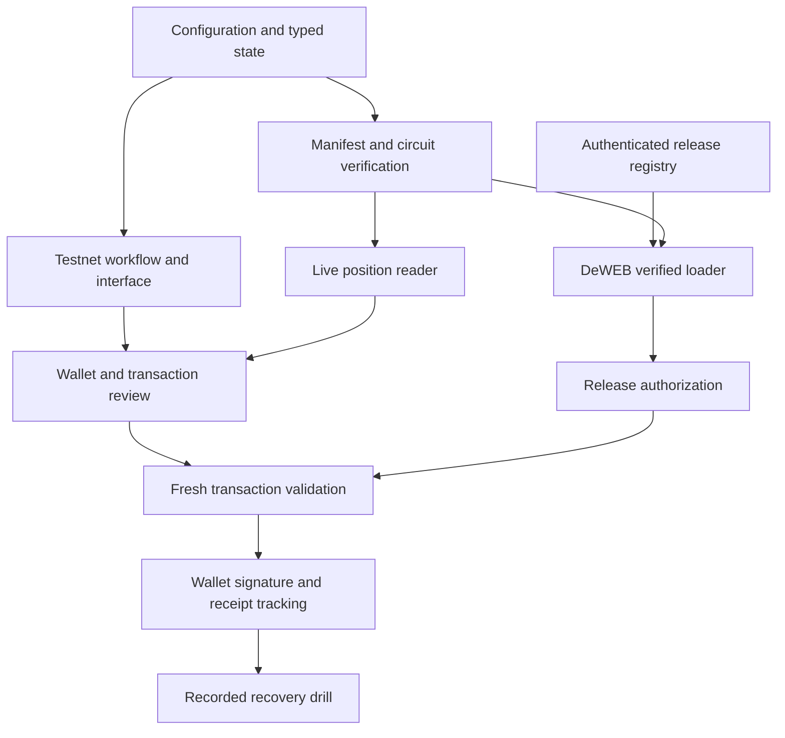

# ExitOS implementation architecture

Revision 2. Updated after the user required actual end to end testnet behavior and prohibited simulated product flows. The research establishes the direction; this document defines the implementation contracts and acceptance criteria. The task checklist records actual completed work. A working local UI does not establish a live verified recovery deployment.

## Product contract

ExitOS gives users a prepared way to perform a supported action when an application's usual website is unavailable. The first adapter covers one deployed ERC4626 test vault on X Layer testnet. Aave V3 supply recovery is a later adapter with a separate verification gate. A release registry admits reviewed recovery bundles through a TapeOut approval circuit. Users sign directly with their own wallet. ExitOS never receives assets or signing keys.

There is one product environment: X Layer testnet, chain 1952. Every position, deposit, recovery and receipt must come from real deployed testnet contracts. No fabricated wallet, fabricated balance, simulated success, fixture position or mock signing flow is permitted. Before deployment the UI shows an honest setup state and disables unavailable actions.

The researched mainnet addresses must not be reused on testnet. If Aave or official TapeOut deployments are absent, the first testnet integration uses a real deployed ERC4626 savings vault, a clearly identified test ERC20 faucet, a TapeOut compatible NAND processor and the actual authenticated release registry. The app labels test assets and protocol provenance. Compatibility is not a claim of official TapeOut registration or mainnet eligibility. Aave mainnet remains the follow up adapter after the testnet pipeline is proven.

## Dependency order

The implementation delivers a real testnet application, deterministic verification utilities, deployed contracts, actual deposit and withdrawal, approved release records and recorded testnet receipts. DeWEB hosting and official protocol registration remain separately evidenced gates.

## Repository map

| Path                    | Responsibility                                                                                       |
| ----------------------- | ---------------------------------------------------------------------------------------------------- |
| `src/app`               | Application shell, route state and theme                                                             |
| `src/components`        | Brand, navigation, aperture, position ledger, dialog and accessible primitives                       |
| `src/features/recovery` | Amount entry, transaction review, progress and receipts                                              |
| `src/features/releases` | Approved release identity, local development status and inspection                                   |
| `src/lib`               | Amount parsing, fingerprints, manifest hashing and circuit codec                                     |
| `src/chain`             | X Layer configuration, ABIs, RPC checks, wallet provider and ERC4626 adapter, followed later by Aave |
| `src/data`              | Public deployment configuration populated only from actual receipts                                  |
| `public`                | SVG logo, tab icon and self contained static assets                                                  |
| `contracts`             | Registry and independently deployed compatible processor sources                                     |
| `scripts`               | Circuit generation, read only checks, contract compilation and copy/security checks                  |
| `tests`                 | Domain tests, contract tests and browser scenarios                                                   |
| `docs/research`         | Migrated evidence and winner research                                                                |
| `evidence`              | Public reproducible verification records                                                             |

Runtime dependencies are React, viem, Zod and Lucide, with bundled fonts. Vite builds static files. No frontend API secret, private key, server generated signing instruction, remote executable dependency or analytics script is permitted. Optional OnchainOS services are later backend features.

## Domain types and state

`Environment = testnet`. `Position` contains adapter ID, chain ID, asset address, token decimals, raw asset/share values as bigint, account, source block and data origin. Monetary values are never held in floating point state. `RecoveryIntent` binds chain, account, adapter, asset and integer amount.

`VerificationReport` records release, manifest, circuit, node agreement, contract identity and freshness separately. Each check is pending, passed or failed with a stable reason code. A display label cannot grant authorization. `PreparedTransaction` includes the exact destination, calldata, value, network, account, pinned source block and an intent digest.

Recovery state is a discriminated union: idle, amount entry, review, preparing, awaiting wallet, submitted, included, confirmed or failed. Every async operation has an operation ID. Results from older IDs cannot replace the current intent. Account, network, environment or position changes cancel preparation, clear approval and require a fresh review. Failure retains the user's amount and a safe retry route.

### A01 Configuration and assets

Define chain 1952, gas test OKB and the actual deployed test token, vault, processor, registry and bundle store. All addresses remain absent until broadcast receipts prove deployment. Keep these constants in one module with source references. Deployment configuration starts with `status: development` and absent registry/circuit commitments. Parse optional public configuration strictly. Never interpret missing values as approved defaults.

Acceptance: wrong chain and malformed addresses reject; missing release credentials make live signing unavailable; changing network cannot preserve a prepared transaction.

### A02 Exact amounts

Use string inputs and integer token units. Accept digits and one decimal separator, reject negatives, exponent notation, extra precision, zero, excess balance and leading/trailing junk. Max uses an adapter derived current limit. Display formatting may round; the signed amount never changes because of formatting. Show the exact value in review.

Acceptance: tests cover one smallest unit, full precision, values beyond JavaScript safe integers, too many decimals, whitespace, comma notation and maximum balance.

### A03 Testnet provenance

Read every visible balance and position from chain 1952. Faucet claims mint explicitly labeled test assets in a real transaction. Deposit requires actual approval and transfer into the deployed ERC4626 vault. Recovery burns actual shares and returns underlying assets. Record genuine hashes and receipt status. An undeployed integration renders unavailable, never unverified data.

Acceptance: claim, approve, deposit and withdraw are recorded on testnet; wallet and vault balances reconcile at receipt blocks; a failed transaction cannot render success.

## UI and UX implementation

### A04 Shell and navigation

Implement Overview, Recovery, Releases and Activity in a responsive split pane shell. Navigation is real route or state driven content, with current selection communicated visually and through `aria-current`. The action column has one obvious primary task. The right pane's doorway shows the current route and selected destination. Mobile keeps primary actions reachable without squeezing the ledger into a desktop table.

Acceptance: every navigation item changes meaningful content; no dead links; 360 px viewport has no horizontal page overflow; keyboard order follows visual order.

### A05 Brand and theme

Build the aperture mark as an original SVG and use it consistently, including the favicon. Bundle IBM Plex Sans and Roboto Slab. Theme defaults to the device preference; an explicit choice persists locally. Apply theme before first paint to avoid flash. The toggle has an accessible name and announces its current action.

Acceptance: both palettes meet contrast targets; reload keeps theme; favicon/title are correct; all fonts and icons work without a third party CDN.

### A06 Overview and position ledger

Show chain, total displayed position value with its origin, supported positions, last local/testnet activity and available actions. A new live connection shows loading, then actual holdings or a useful empty state. Display unsupported balances separately from recoverable holdings. A dollar estimate is not represented as guaranteed sale proceeds.

Acceptance: loading, no holdings, unavailable RPC, disconnected wallet and positive position states are implemented; unverified totals are labeled; asset contract details are expandable.

### A07 Recovery dialog

Opening recovery focuses the dialog heading. Amount entry has asset, balance, exact amount, Max and an explicit Continue control. Review shows action, token amount, destination wallet, protocol target, network, gas source and verification state. Confirming a testnet action says it is testnet. Live review explains the first failed gate and cannot silently downgrade verification.

Escape and the close button work before signing. Background content is inert while open. Focus remains trapped and returns to the trigger. During wallet interaction, dismissal does not erase a submitted transaction. Failures have a specific retry action; completed recovery returns to refreshed holdings.

Acceptance: amount errors are associated with inputs; focus trap and return work; review cannot be skipped; double clicks cannot submit twice; account changes invalidate review.

### A08 Motion and aperture

One coordinated entry timeline reveals navigation, workspace and doorway. The doorway changes state in response to choosing a position and completing recovery. Short state transitions communicate intent and completion. No ambient loops, repeated section entrances or card lifting. Reduced motion removes transformations and preserves every state cue in text and shape.

Acceptance: no animation blocks input; reduced motion test passes; layout does not jump when numbers or verification messages update.

### A09 Releases, activity and kit export

Release inspection exposes version, source identity, manifest fingerprint, circuit identity and development/approved/revoked status. Testnet records are labeled. Activity distinguishes unverified completion from actual submitted/included/confirmed transactions. A recovery kit export contains public adapter/release identities, origin, environment and date, never credentials. A saved development kit is not advertised as a deployed recovery route.

Acceptance: export content matches displayed environment; empty activity is useful; copy/export controls confirm the actual operation; external links use safe target attributes.

## Manifest, loader and release identity

### A10 Canonical manifest

Define a strict versioned schema: chain, project, sequence, registry, container, site identity, source commit, asset path/hash/size/content type, adapter version, contract implementation identities and allowed selectors. Reject unknown fields, duplicate paths, absolute paths, traversal, unlisted executable resources and unbounded file sizes. Canonical serialization recursively sorts object keys and preserves array order. Commit to UTF8 bytes using SHA256; circuit netlists use their explicitly documented identity hash.

Acceptance: key ordering preserves the commitment; asset changes alter it; malformed/path traversal manifests reject; limits prevent attacker controlled memory allocation.

### A11 Bundle verification before execution

The trusted bootstrap reads the admitted root, then verifies the manifest and every executable asset before returning executable bytes. Do not mount an iframe or import scripts until this finishes. Hashing a page after its scripts run provides no boundary. Unknown content type and zero hashes reject. Cached files are keyed by container, path and approved hash.

Acceptance: tampered HTML, JS, CSS, manifest and mutable publisher updates reject before any script side effect; cache from another release cannot satisfy the current root.

### A12 DeWEB origin and availability

Integrate the pinned TapeKit kernel with one genuine origin per site, using the reference Service Worker gateway. Preview mode is read only and never receives wallet injection. Keep bootstrap and verifier outside the recovery payload. Permit only required RPC origins; treat mobile wallet connections separately. Validate SiteRegistry and binding implementation slots, activation state, sizes and hashes at one block.

The browser MVP trusts its bootstrap. Service Workers can update; hard reload can bypass them. Stronger native or independently pinned bootstrap delivery is a separate feature. Prepaid activation expiry is shown and monitored; onchain storage is not described as perpetual service availability.

Acceptance: actual browser wallet connection from the chosen origin; normal application/backend outage does not prevent verified opening; gateway/RPC failures remain visible and signing stays blocked.

### A13 Release authorization

Read current immutable release records and revocation state from the configured registry. Bind project, sequence, container, manifest and source to the prepared link. Never trust a mutable publisher's latest hash as identity. Old release code may be cached, but current revocation and protocol identity must still be checked before signing. Missing registry configuration means development mode.

Acceptance: unapproved and revoked roots reject, old approved root is not silently relabeled current, mismatched project/chain/container rejects.

## Circuit and registry

### A14 Circuit codec and policy

Implement the TAP NAND record format: opcode zero plus two unsigned 24 bit big endian signal references. Signals zero/one are constants; four input bits begin at index two; output is the last signal. Compile the publisher quorum plus reviewer policy to eight NAND gates, one output and no state. Store binary, dimensions, hash and all sixteen vectors in generated public artifacts.

Acceptance: independent predicate and evaluator match all sixteen inputs; exactly four permit; malformed opcode, future signal, incomplete record and invalid dimensions reject. Generation is reproducible.

### A15 Registry authorization

Deploy one small non upgradeable registry with an immutable project ID and four distinct nonzero EOA reviewer roles. EIP712 release admission binds chain, registry, project, operation, nonce, expiry, container, manifest root and expiry. The canonical manifest binds the exact executable module and contract identities. Verify canonical low s signatures, recover each known signer, reject duplicates and derive the four bits internally. Circuit input flags are never supplied as authority by the caller.

The testnet registry pins processor runtime code identity and circuit metadata/netlist commitment. The official production path additionally verifies factory membership and the relevant beacon implementation. Bound static call gas, require exactly one output byte equal to zero or one and reject errors. Admission requires the circuit's true output. Store immutable release data and emit an event. No payable function, custody or arbitrary external call.

Acceptance: two publisher approvals without reviewer fail; reviewer and one publisher fail; two publishers plus reviewer pass; malformed/replayed/cross domain/duplicate/unrecognized signatures fail; altered circuit implementation/netlist and malformed outputs fail.

### A16 Revocation and actual testnet deployment

Revocation signs a separate operation type, release identity and next nonce, with the same authority. Old records remain inspectable with a revoked flag. A release may be revoked once; no admission signature can authorize revocation. Signer rotation and ERC1271 support require a separate version, not an emergency shortcut.

On testnet, first check official processor availability. If absent, deploy the clearly identified compatible processor and immutable netlist, with the exact published TAP NAND semantics. Do not claim it is registered in the official ecosystem. On the later mainnet path, publish the circuit on an existing registered processor after reading current fees and transistor requirements. Compare the live netlist/output with the generated artifact. Deploy the registry against that identity, verify source and constructor arguments, admit the exact bundle and record receipts. No real user funds are involved in registry admission.

Acceptance: actual testnet contract checks cover mutation/replay and circuit failure; public addresses remain absent until actual deployment; live verification evidence is captured before enabling signing.

## RPC, wallet and recovery execution

### A17 Independent RPC agreement

Model operator identity separately from URL. The two default OKX domains count as one operator; a proxy to OKX is not independent. Query candidates, select a shared recent block and compare its hash, identity and all critical reads. Bound timeouts and concurrency, abort superseded requests, reject divergence and stale blocks. Do not silently fall back to one operator for authorization.

The initial testnet journey uses one OKX operator and discloses this limitation in review and the standalone kit. Mainnet recovery requires independent operators before writes. Provider URLs with embedded credentials cannot be bundled or exported. Paid private RPC access needs a design that avoids recreating the application's backend as the sole recovery dependency.

Acceptance: same operator on multiple URLs does not satisfy quorum; mismatches, pruned state, timeout and stale head fail explicitly; browser CORS is tested.

### A18 Wallet connection

Use an EIP1193 injected provider. Enumerate available providers when supported and favor OKX without impersonating another wallet. Request accounts only after a user action; listen for accountsChanged, chainChanged and disconnect, and remove listeners on teardown. Use wallet_switchEthereumChain and a reviewed add chain request for 1952 after an explicit action. Never ask for a seed or private key.

Acceptance: unavailable wallet has a useful install/readonly route; rejection preserves state; wrong network does not trigger writes; concurrent connection attempts deduplicate; listener cleanup is tested.

### A19 Testnet vault reader and later Aave adapter

For the initial ERC4626 integration, verify deployed runtime code and asset identity, read balanceOf, convertToAssets, maxWithdraw, maxRedeem and wallet token balance. Use the exact supported vault and asset only. For the later Aave integration, verify getPool matches the reviewed pool; check proxy bytecode and implementation slot; read reserve token identities, decimals, aToken balance, liquidity/configuration and user debt across relevant reserves. Restrict MVP to the reviewed asset and no debt. Use protocol semantics for paused/frozen states instead of assuming every configuration flag blocks withdrawals.

Acceptance: zero holdings, debt, unexpected asset/token identity, changed implementation, paused action and unavailable liquidity produce explicit unsupported/failure states; raw amounts and source block survive to review.

### A20 Prepare constrained transaction

For the testnet vault, construct only withdraw(amount, connectedAccount, connectedAccount) with zero native value. Deposit and faucet are separate explicit setup transactions. The later Aave adapter constructs withdraw(asset, amount, connectedAccount). Decode it again and compare to the intent. Reject arbitrary destinations, selectors, recipients or extra value. Read contract limits from fresh state and estimate gas as a transaction safety check, without generating fake transaction outcomes. Store full calldata and intent digest with the source block. Never fetch opaque signing instructions from an AI model or a trusted backend.

Acceptance: wrong destination/recipient/asset/value/calldata mutation fails; precision stays exact; revert and insufficient OKB are displayed; only a real receipt is represented as chain settlement.

### A21 Final gate and wallet request

Immediately before signing, reacquire account/chain, current release/revocation, circuit/contract identities, node agreement, freshness, debt/position and current contract limits. The intent digest and reviewed values must still match. A pending guard or unsupported configuration disables the request. Perform exactly one wallet request per operation ID. The original protocol remains the final authority on its own withdrawal rules.

Acceptance: account/network/version changes between review and signing reject; a caller cannot forge a display report into authorization; testnet signing reaches this function only after its disclosed testnet checks pass.

### A22 Receipt and refresh

Record actual returned transaction hash, network and submitted intent. Track pending, included, reverted and safe/finalized state separately. A timeout is still pending, not failed. On success, validate the relevant event and balances at the receipt block and refresh positions; keep OKB gas separate from asset amount. Page reload can resume a public pending transaction record without persisting credentials.

Acceptance: rejected wallet, duplicate submit, RPC timeout, reverted receipt, reorg and delayed safety updates have deterministic behavior; unverified hashes never enter the live tracker.

## Operations and commercial features

### A23 Maintainer readiness and optional OnchainOS

Later backend work records review versions, activation expiry and drills. Optional balances/history supplement dashboards. API HMAC credentials remain server side; serialization and quota errors are tested. Optional billing uses one fixed price method first, with durable payment IDs and separate authorized/settled states. Recovery has no subscription or login paywall. Do not depend on currently unavailable task escrow or whitelisted simulation.

Acceptance: backend outage leaves the prepared route usable; payment retries cannot double charge; cancellation does not misrepresent prepaid hosting expiry; no API secret appears in Vite environment or emitted JS.

### A24 Pilot and evidence

Obtain authorized maintainer/user participation. Demonstrate the current fallback, integrate one supported real contract and measure a controlled outage drill. Record chain, users, completion times, bundle hash, source blocks and receipts. Team controlled testnet wallets are not users. Public incident prevention is not claimed from a controlled demonstration.

Acceptance: five user drills and one concrete maintainer quote are targets until recorded; the submission describes actual results and unsupported cases.

## Quality, security and release

### A25 Automated validation

Run TypeScript, domain tests, actual testnet security transactions, production build and browser scenarios. Browser coverage includes both themes, 360/768/1440 px, keyboard dialog operation, reduced motion, all testnet steps, amount failures, provider rejection, empty live holdings and gate rejection. Scan product copy for em dashes, decorative hyphens and emojis. Use a focused secret scan on tracked source and built JS, without printing matching secrets.

Acceptance: each test checks behavior or security invariants; screenshots are inspected; no console errors, overflow, missing assets or fake clickable controls remain.

### A26 Commits, push and launch

Commit completed checklist steps separately with sole author and committer dotmantissa <negativemantissa@gmail.com>, no coauthor trailers. TASKS.md and agent instruction files remain ignored. Before staging, inspect exact files and scan credentials. Before pushing, verify GitHub authentication is dotmantissa and the target is https://github.com/dotmantissa/exitos. Credentials stay in hidden stdin/process memory, not remote URLs/config/files.

Push exact validated main and compare remote head. Private presentation deployment may expose only the same verified development/testnet status. Live DeWEB and funds operations require their actual technical gates; a polished website never substitutes for them. Prepare the strict three minute video and submission package from recorded evidence, with a buffer before the provisional deadline.

## Ready for live recovery checklist

- Actual circuit and registry deployed, source reproducibly compiled, identities pinned and admission recorded.
- Exact DeWEB bundle approved and verified before execution from a tested wallet compatible origin.
- Independent browser node agreement and fresh contract/debt checks pass.
- Adapter succeeds on actual testnet for intended states and rejects all unsupported states.
- Tiny authorized live exercise completes with genuine receipts and balance evidence.
- Reviewer and pilot findings resolved, recovery scope and bootstrap trust disclosed.

Until these conditions are met, the app remains a development implementation with a testnet journey whose certification requires actual recorded transactions and live read capability. That boundary is part of the product's engineering, not a visual placeholder.

## Testnet deployment additions

A27: Deploy ExitUSD, a daily faucet token with a per address claim limit with no monetary value. Deploy ExitVault using the OpenZeppelin ERC4626 implementation with virtual share protection. Deploy the eight NAND processor, authenticated registry and immutable bundle store. Contract bytecode and roots must match compiled artifacts. Store addresses, hashes and deployment receipt blocks in public JSON. Keep deployer and reviewer keys in an ignored local file with mode 0600.

A28: Publish and verify the recovery bundle bytes on testnet before recording its approved root. The loader must read and hash the actual stored bytes before executing payload code. This is a testnet compatibility integration, not an invented official DeWEB identity. The full official DeWEB path needs authentic ecosystem addresses or a later mainnet deployment.

A29: Run actual testnet checks: faucet claim, approve, deposit, release admission, circuit truth table, recovery, balances, replay rejection, bundle hash and receipt confirmation. Do not create simulated UI evidence. Deterministic math/schema tests remain useful; end to end certification comes only from actual testnet calls and receipts.

## Exact implementation contracts for the current build

This section is authoritative for the first testnet implementation. Earlier DeWEB, independent operator and Aave sections describe subsequent production gates rather than implemented features.

### File and function order

1. `src/chain/config.ts` parses `src/data/deployment.json` using a strict schema. `status: undeployed` yields no usable deployment. A deployed entry requires all five addresses, runtime code hashes, root, circuit hash, four reviewers, release ID, real transaction hashes and receipt block. The reader and wallet use chain 1952 exclusively. Technical scripts use the same public endpoint without credentials.
2. `src/lib/amounts.ts` parses decimal strings into bigint units with exactly eighteen decimals. Every caller rejects zero, excess precision and an amount beyond its current limit. The review preserves the input amount; rendering is never used to construct signing data.
3. `src/lib/circuit.ts` encodes eight NAND records and evaluates the final signal. Inputs zero through two represent publishers. Input three represents the safety reviewer. The independent predicate is at least two publishers and the reviewer. Exactly masks 11, 13, 14 and 15 pass.
4. `contracts/ExitUSD.sol` mints 1,000 XUSD through `claim()` once per address per day. It has no owner, price feed or monetary value. `contracts/ExitVault.sol` uses OpenZeppelin ERC4626 and a six decimal virtual share offset. It has no operator withdrawal privilege.
5. `contracts/ReleaseProcessor.sol` fixes the exact immutable eight gate netlist. `contracts/ReleaseRegistry.sol` pins its code and circuit, stores four unique EOAs, rejects unknown and duplicate signers, derives the policy bits itself, and consumes a monotonically increasing nonce. Revocation uses a separate operation and leaves the original record inspectable. The registry holds no funds.
6. `scripts/deploy-testnet.ts` deploys the asset, vault, processor and registry in dependency order. It calculates the actual next CREATE address for the store. The manifest includes this address, every relevant contract identity and the recovery module hash and size. It deploys the exact canonical bundle to `BundleStore`, then admits its root using two publisher signatures and the reviewer signature. The local deployment journal records transaction hashes before awaiting inclusion. A retry resumes those hashes instead of broadcasting replacements.
7. `src/chain/verification.ts::verifyRelease()` checks the node network and recent block, all five runtime code hashes at that block, current release and revocation, project ID, processor, reviewer roles, circuit commitment and dimensions, vault asset, store commitment, canonical manifest root and exact module size and hash. The executable allowlist contains one file, `recovery.js`. It returns bytes only after every gate passes. The browser uses one node operator on testnet and states this explicitly.
8. `src/chain/position.ts::readPosition()` reads shares, wallet balance, allowance, maximum withdrawal, next claim timestamp and gas from the same block. `convertToAssets` supplies the displayed asset amount. `prepareTransaction()` rechecks the release and current holdings, constructs a fixed destination and selector, decodes withdrawal calldata again, estimates gas and rejects insufficient gas balance.
9. `src/chain/wallet.ts` requests accounts only from a click. It offers explicit network switching and listens to provider changes. The app's operation generation invalidates old reads and reviews. Immediately before signing, the app reacquires account and chain. It sends one request while the signing lock is held.
10. `src/app/App.tsx` implements Overview, Recovery, Releases and Activity. A deposit with insufficient allowance first reviews an exact allowance and then requires a separate deposit review. Claiming is a separate transaction. Withdrawal is always `withdraw(amount, connectedAccount, connectedAccount)` with zero native value. The native dialog traps focus and makes its background inert. Closing cannot abandon an unresolved signing request.
11. Receipt handling checks the actual returned transaction sender, target, calldata and value. Successful deposit and withdrawal require the expected ERC4626 event and exact asset amount. A timeout remains a tracked pending hash. A reverted receipt cannot display completion. Activity stores only public account, hash, action, amount, timestamp and receipt status in browser storage.
12. `public/recovery/recovery.js` is the reviewed standalone interface stored on the chain. `src/recovery-bootstrap.ts` executes its verified bytes through a Blob module only after all release checks. It supplies a narrowly constrained withdrawal function that repeats the signing and receipt gates. The module cannot request arbitrary transaction destinations through that interface. Approved executable code remains trusted code, and runs with the bootstrap origin's privileges.
13. `scripts/build-kit.ts` bundles the verifier, public deployment pins and fonts into one HTML file. It contains no application asset dependency. The file is generated and ignored in Git. The Service Worker saves that file for the browser; downloaded copies preserve their original pins. Browser wallet support and RPC CORS are delivery requirements to verify, not assumptions of universal support.
14. `scripts/verify-testnet.ts` performs all sixteen actual circuit calls and writes public evidence. `scripts/testnet-e2e.ts` sends real claim, allowance, deposit and withdrawal transactions, checks receipt events and reconciles token and share balances. It sends actual replayed and unsigned admissions and requires reverted receipts. `scripts/testnet-security.ts` exercises a separate real registry so testing revocation cannot disable the application's approved release.
15. Browser checks inspect disconnected, empty, error and responsive states without inventing balances. The funded signing suite uses a controlled test account and a local signing transport; every request goes to the actual testnet. It verifies complete wallet journeys, dialog focus, account changes and the standalone route. Public evidence must identify these as team controlled wallets rather than customers.

### Completion evidence and remaining gates

The implementation can be committed before funding, but deployment and certification remain pending until actual receipts exist. The UI must remain disabled in that state. Public JSON is generated from successful receipts rather than hand filled examples. After deployment, regenerate the recovery kit, rerun the verifier, perform the actual security suite, complete browser signing checks and then build and push.

Official TapeOut factory registration, actual DeWEB site/container identity, independent RPC operators, external reviewer approval, customer drills, marketplace billing and Aave support are separate gates. They are not represented as working features by this initial testnet application. Eligibility must be resolved with genuine official ecosystem capabilities before a winning entry can be claimed ready.

## Production website delivery

The requested website address is `https://exitos.vercel.app`. The product environment remains X Layer testnet, chain 1952. Hosting on a production domain does not change the value of test assets or establish official protocol registration.

1. Link the authorized `exitos` Vercel project. Keep project linkage and account credentials in ignored local files. The repository uses the Vite framework, `npm ci`, `npm run build` and the `dist` output directory.
2. Exclude `.local`, environment files, Git internals, task notes, agent instructions, dependency directories, research caches and browser artifacts from deployment. Run the Vercel upload dry check and examine actual file entries before publishing. Empty ignored directory records contain no file data.
3. Generate the standalone recovery HTML during the cloud build. Its verifier embeds the committed public deployment identities and bundled fonts. The payload continues to come from the admitted immutable bundle on testnet.
4. Use static filesystem routing. Application navigation uses URL hashes. A missing private path must return 404 rather than application HTML. Never add a blanket SPA rewrite that makes private file checks ambiguous.
5. Apply content type protection, frame restrictions, referrer privacy and a permissions policy. The content policy permits bundled fonts and the inline standalone bootstrap, the verified Blob module, injected wallet extensions and the public X Layer RPC hosts. Block objects and external application frames.
6. Keep the Service Worker and recovery HTML revalidated so new visits can receive current pins. Saved copies retain their original verifier trust boundary and must still recheck current approval and revocation on the chain.
7. Publish the committed, validated source. Record the Vercel project, deployment identifier, ready state and literal assigned URL in the ignored task checklist. Confirm the exact `exitos.vercel.app` alias without replacing another project's domain. Automatic project domain registration returned a 409 conflict even though explicit alias assignment succeeded. Run the explicit alias command after every future production deployment and verify the exact public address. Do not assume the generated project domain is the requested one. Public production access must be verified without an authenticated Vercel session.
8. Check the live page, original logo and favicon, security headers, RPC connectivity, both themes, recovery bootstrap and the absence of private files. Exercise the live standalone recovery flow with actual testnet signatures and receipts. If the RPC or wallet cannot be reached, keep the verification gate closed and report the observed limitation.

Acceptance requires a ready production deployment, the exact requested alias, a functioning live recovery route, recorded real transaction evidence and a clean source push by the specified sole author.
