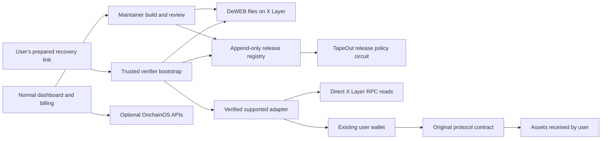

# ExitOS build plan

Planning date: 29 October 2026. All components below are proposed work. The current workspace contains research and read-only verification, not a working product.

**Product promise:** prepare verified recovery access before a frontend incident, so users can complete a narrowly supported action through their existing wallet when the normal application interface is unavailable. The protocol contract must still allow the action.

## Customer, problem and boundary

Buyer: a protocol maintainer responsible for release operations and user access. User: a person with a supported X Layer position who needs to withdraw or revoke a specified allowance. Initial scope: one Aave V3 X Layer supply withdrawal with no outstanding debt, plus an explicit-token/explicit-spender allowance revocation if time permits.

Aave has published X Layer addresses. Read-only checks found deployed provider/pool bytecode, the provider's `getPool()` returned the published pool, and the proxy implementation matched the address book at the checked block. This makes it a concrete demonstrator, not a commercial partner. A successful withdrawal, reserve suitability and user demand remain unverified. [Aave address book](https://github.com/aave-dao/aave-address-book/blob/main/src/AaveV3XLayer.sol).

The intended incident is failure or compromise of the **normal application's** web delivery. ExitOS does not recover stolen keys, reverse transfers, cure insolvency, bypass paused contracts, repair exploited protocol logic or operate without chain access. A first-time user also needs a trustworthy way to discover the recovery interface. Installation/preparation must happen before the incident.

The MVP trusts its gateway/verifier bootstrap and approved reviewers. Verifying bytes against chain is not a security audit. A malicious gateway bootstrap, a compromised user's device or sufficient compromised reviewers remains a relevant failure. Do not market browser Service Worker installation as an immutable root of trust; browsers can update Service Workers and hard reload can bypass them. [TapeKit specification](https://github.com/TapeOutProtocol/TapeKit/blob/main/SPEC.md).

## One user journey

**Preparation:** a maintainer builds the small adapter bundle, records supported contracts and versions, publishes its bytes on DeWEB, obtains release approvals and gives users the recovery link plus release identity. Users test the wallet connection while the normal site is healthy. A readiness dashboard records the last successful drill and activation expiry.

**Recovery:** the prepared link opens the trusted verifier; it reads release records and DeWEB files, verifies the manifest and hashes before executing the bundle, reads the user's supported position, shows the withdrawal details, asks the existing wallet to sign, and tracks the actual receipt. No product account, OnchainOS credential, payment or customer-support interaction is required on this path.

**Maintenance:** changed protocol implementations, wallet behavior, RPC access or bundle releases trigger a new review/drill. This repeated operation is the subscription hypothesis. We sell maintenance of the route, not a promise that all losses can be prevented.

## Architecture



Use TypeScript, a small static Vite application or equivalent, viem for EVM reads/calldata, an EIP-1193 injected wallet, and Foundry for registry/fork verification. Pin dependencies and record the TapeKit revision. No runtime CDN, remote script, AI-generated calldata or arbitrary ABI execution in the recovery bundle. An optional backend handles analytics, interviews/pilot records and billing; it has no user signing keys.

The gateway must use an independent HTTPS origin per DeWEB site. The preview iframe is unsuitable for wallet use. Keep the verifier outside the untrusted site payload, verify all referenced scripts/styles before executing them, and enforce offchain-request policy explicitly. An ordinary page that verifies only itself can be replaced together with its verifier; it does not provide the claimed boundary.

For the hackathon browser MVP, use the open reference Service Worker gateway and a clearly disclosed trusted bootstrap. Stronger bootstrap protection through a signed native shell or independently installed verifier is later work unless the initial spike proves it small enough. Do not invent a secure historical-release URL format; test the actual loader and manifest pinning behavior.

## Release identity and manifest

Each immutable release record commits to chain ID, registry/project identity, manifest hash, DeWEB container/site identity, release sequence, source commit, circuit identity and approval digest. The canonical manifest contains hashes for every executable asset, supported adapter version, contract/proxy/implementation identities, selectors and allowed transaction shapes. Use a fixed serialization and reject unlisted executable resources.

The verifier compares loaded bytes to the **approved release commitment**, not merely the latest hash supplied by a mutable publisher. Publication on DeWEB and admission to ExitOS are separate: a publisher may upload unapproved bytes, but the trusted loader must refuse to execute them. New records do not overwrite old roots. A revoked release cannot be presented as current; contract upgrades cause incompatible adapters to refuse signing until revalidated.

Historical bundles may be cached for availability, but fresh chain status is still required for signing. A cache is not evidence of a current unrevoked release or current protocol state. Account for DeWEB activation/payment expiry and RPC access; do not claim perpetual hosting merely because data is stored onchain.

## Meaningful TapeOut circuit use

Deploy or reuse a small combinational circuit for **new release admission**, called by the registry contract during admission. For the first version, fix the signer roster at registry deployment: three publisher addresses and a distinct security-reviewer address.

Policy:

```text
allow = ((publisherA AND publisherB)
      OR (publisherA AND publisherC)
      OR (publisherB AND publisherC))
      AND securityReviewer
```

This can be expressed with eight NAND gates, four inputs, one output and no state. It has sixteen input combinations, four of which permit admission. The actual circuit must be compiled, independently exhaustively checked and deployed during the event. No ExitOS circuit has been created yet.

Before calling `eval`, the registry verifies signatures over the exact release digest using chain/contract/project domain separation, release nonce, expiry and manifest commitment. It derives each approval bit from verified roster membership and rejects duplicate signers. The caller never supplies trusted approval flags directly. Reviewer approval attests review; it does not mathematically prove the software is safe.

The registry pins the circuit processor/ID, netlist identity, expected dimensions and relevant implementation identity. Bound the static call's gas, require strict output encoding, and reject errors or malformed outputs. A circuit's `eval` is read-only, but its result can gate a state-changing registry transaction. By itself, an offchain `eth_call` does not enforce publication or spending.

Keep the registry small and non-upgradeable with append-only records. Any revocation action uses equally authenticated authority. Limit signer-rotation/governance scope; a production rotation design needs separate review. Circuit policy portability and replayable inspection are the ecosystem contribution. Do not claim this quorum policy is inherently more secure or cheaper than equivalent Solidity.

The recovery withdrawal remains a direct user-signed call to the original protocol. ExitOS does not insert a vault, take custody or require a funds-holding smart account.

## Transaction adapter constraints

For the first Aave adapter:

- Bind chain 196 and the reviewed pool/provider/asset contracts. Verify proxy and implementation identity against the approved manifest using the appropriate storage checks.
- Read the position, relevant reserve state, liquidity and outstanding debt. Restrict MVP to verified no-debt supplies; refuse unsupported debt/borrow cases and unexpected token types.
- Construct only the reviewed `withdraw(asset, amount, recipient)` call. The recipient must be the connected account. Show the exact asset contract, amount, recipient, destination and network in ordinary language with expandable technical details.
- Simulate with the user's address using direct RPC; estimate gas and require enough OKB. `eth_call` checks execution at a block but does not guarantee later success or independently prove all balance effects.
- Re-read critical state and reject changed accounts/chains/implementations before signing. Track receipt and asset balance/event outcomes. Distinguish submission, inclusion and safe/finalized status.

If revocation fits, support `approve(knownSpender, 0)` for one reviewed token. Revocation cannot reverse prior transfers or erase other permissions such as unrelated Permit2 allowances. No blanket promise to revoke every approval, support every token or auto-detect every malicious spender.

Gas is a real prerequisite. Prefer a normal funded wallet for the first demonstrator. A facilitator's promotional gas sponsorship is not a reliable emergency dependency. Do not add swaps or bridging just to obtain gas during the MVP flow.

## Go/no-go gates

| By date | Required evidence | If it fails |
|---|---|---|
| **1 Nov** | Wallet signs from actual intended DeWEB origin; verified bundle loads before execution; altered asset rejected | Fix the origin/verifier design immediately; do not claim a secure mirror with only a normal hosted page |
| **1 Nov** | Two independent RPC operators usable from browser, including pinned reads and mismatch handling | Obtain a tested dedicated independent node route; no claim of independent quorum until verified |
| **1 Nov** | Bounded Aave withdrawal works on a pinned fork; wrong chain, recipient, upgraded implementation and debt cases rejected | Select a genuinely supported simpler adapter or narrow to release/drill tooling |
| **1 Nov** | At least five maintainer interviews and one explicit pilot commitment | Test ReleaseKit's narrower buyer hypothesis; reselect if no buyer need emerges |
| **8 Nov** | Registry actually calls the circuit; all sixteen vectors match; approval replay/duplicate tests pass | Simplify roster and policy; don't present a UI indicator as onchain enforcement |
| **15 Nov** | One real external tester completes the honest core journey; one maintainer accepts a concrete maintenance quote | Improve UX/problem choice before adding features |
| **22 Nov** | Five target users can complete a controlled outage drill; protocol support scope is recorded | Remove confusing steps and unsupported claims; repeat the failed drill only after a change |

Five interviews, a pilot and the quoted targets are goals, not facts. No interviews or outreach have occurred. The user must authorize contacting external people. Use genuine external participants; team-controlled wallets count as team tests.

## Scope and cuts

**Required:** one demonstrator adapter, one desktop wallet journey, verified DeWEB bundle, authenticated circuit-gated release record, one clean tamper rejection, one backend-outage drill, explicit error handling, source and deployment evidence, readable commercial proposal and a video under three minutes.

**After the core passes:** a second protocol adapter, mobile wallet access, activation monitoring, one-time service billing and a simple maintainer dashboard. Add subscriptions only after the payment/access spike and recurring need are established.

**Exclude:** new tokens, yield strategies, trading bots, bridge execution, PoD mining, an agent marketplace, generalized recovery from hacks, automatic contract repair and a full frontend/circuit IDE. The event does not require every named ecosystem project.

FabX can provide existing circuit/component infrastructure if the chosen path benefits from it. TapeCode can assist with packaging/development after source review. TapeSend might carry signed release notices later, but it is not the discovery/identity anchor during an incident. These are optional extensions, not checkbox integrations.

## Commercial validation and distribution

Interview maintainer/operator roles about the last frontend/RPC incident, users affected, current fallback, who owns release approval, frequency of upgrades, drill cost, budget authority and procurement. Ask them to demonstrate their current fallback. A positive reaction to the idea is weaker than agreeing to test a concrete adapter and quote.

Working price hypotheses: **$250–$1,000 setup per supported integration**, then **$99–$299/month** for compatibility checks, prepared releases, activation monitoring and scheduled drills. These are experiment ranges, not proven pricing. The withdrawing user pays no ExitOS fee; avoid a paywall during an incident.

Retention hypothesis: protocols and wallets change, so stale recovery routes need ongoing maintenance. Reports should show tested versions, last drill, measured completion, unsupported cases and activation expiry. If maintainers can do this cheaply with existing IPFS and their own scripts, the service needs a narrower niche or better economics.

Proposed distribution: one pilot maintainer embeds the prepared recovery link in documentation while healthy; publish a small open adapter template and reproducible drill evidence; participate in authorized official feedback sessions; pursue X Layer ecosystem discovery after a functional pilot. These are future actions; no contact or official support is assumed. Published official PR support for winners is conditional on winning.

Planning example: ten customers at $199/month produce **$1,990 monthly revenue**. If infrastructure is $200/month and each customer consumes two support hours at an internal $40/hour, contribution is **$990/month** before sales, audits, taxes and other costs. This scenario is arithmetic, not a forecast. Custom adapter review and support can dominate costs; measure them during the pilot.

Budget assumption before team labor: approximately $1,000 for infrastructure/provider access, deployment/activation costs after live quotes, usability incentives, narrow independent review and contingency. This does not purchase a full production security audit. Do not treat the prize as upfront funding; prize payments are staged.

## Schedule through submission

| Dates | Work and accountable deliverable |
|---|---|
| **30 Oct–1 Nov** | Feasibility and customer gates; choose one asset/adapter and record the decision |
| **2–8 Nov** | Static recovery bundle, trusted loader, minimal registry and release circuit; local/fork evidence |
| **9–15 Nov** | Complete wallet journey, pilot integration, error handling and basic dashboard; tiny live exercise only after later authorization |
| **16–22 Nov** | Outage/tamper drills, external usability work, compatibility checks and targeted review |
| **23–29 Nov** | Fix pilot findings; add billing or mobile only if required core is stable; collect evidence |
| **30 Nov–3 Dec** | Feature freeze, submission README, address list, reproducibility and video rehearsal |
| **4 Dec** | Submit the complete reviewed entry when authorized; verify form receipt and access links |
| **5–7 Dec** | Submission buffer and critical fixes; monitor any official deadline changes |

Engineer A owns circuit/registry/adapter/fork verification. Engineer B owns loader/DeWEB/wallet/UX. Product/design owns interviews, pilot, usability evidence and video. With four members, the fourth can own integration testing and documentation. With two, divide these responsibilities explicitly. The schedule assumes about 250–280 engineering hours total; if availability is much lower, prefer ReleaseKit's narrower scope.

## Verification that matters

Use exhaustive policy truth tables, signature/domain/replay/duplicate/revocation tests, bounded circuit failure tests and forked withdrawal edge cases. Test tampered HTML/scripts/manifests, mutable-site updates, store implementation mismatches, expired activation, divergent RPC responses, missing wallets, account/network changes, insufficient gas, rejected signatures, stale state and protocol reverts.

Perform the core drill with the normal application hostname and the ExitOS backend deliberately inaccessible while independent chain access remains available. Also fail the recovery gateway/bootstrap itself to document the remaining availability boundary. If RPC verification fails, display the cause and refuse signing; do not silently relax quorum. Cached read-only content may remain useful with explicit stale status.

Measure completion rate and elapsed time for actual testers; a target such as four of five successful users within two minutes is a hypothesis until measured. Capture network logs, bundle hashes, pinned blocks, receipts and exact commands. Do not report controlled demo wallets as adoption or synthetic data as real user demand.

## Three-minute video

Target **2:45**, leaving fifteen seconds below the strict form limit.

| Time | What the viewer sees |
|---|---|
| 0:00–0:20 | Specific user problem and supported position; name protocol maintainer as buyer |
| 0:20–0:40 | Prepared release/link and the deliberately unavailable normal website |
| 0:40–1:35 | Open verified recovery route, inspect withdrawal, wallet approval and actual outcome |
| 1:35–2:05 | Modified bundle rejected; approved release and circuit admission evidence |
| 2:05–2:30 | Pilot/drill evidence and proposed maintenance price, clearly distinguishing results from targets |
| 2:30–2:45 | TapeOut/X Layer integration, relevant addresses, live link and next launch milestone |

Keep signing/inclusion clips legible. If portions are sped up, label them. If a segment uses a fork, label it. Never imply that a controlled outage is a public incident or that a simulated receipt is a mainnet transaction.

## Submission package

Prepare team background and size, project pitch, target users, acquisition route, revenue model, why users return/pay, public source, live access link, strict-length video, chain ID and deployment addresses. Include the circuit processor and ID, release-registry contract, DeWEB identity/container and which ecosystem features do real work.

Provide a reviewer quickstart, one clean path through the demo, version-pinned commands, evidence of event-period development, test scope, adapter limits and trust assumptions. Identify any preexisting borrowed code and its license. Existing source can be used; only substantial additions during the event are judged.

The official form allows early registration and later updates and offers livestream feedback. Prepare the entry now, but submitting it, contacting mentors/teams, spending funds and deploying are future authorized actions. [Official form](https://docs.google.com/forms/d/e/1FAIpQLScyVnDmyzxRyBxszLUWbwV5kVbpmZJ3JS6oyOxqjALRvhR1kg/viewform).

For Demo Day, prepare a live run, transparent recorded fallback, known network requirements and answers to: why use this over IPFS; what the circuit really enforces; who authenticates inputs; what happens if the gateway/RPC fails; who pays; and which claims have actual pilot evidence.
